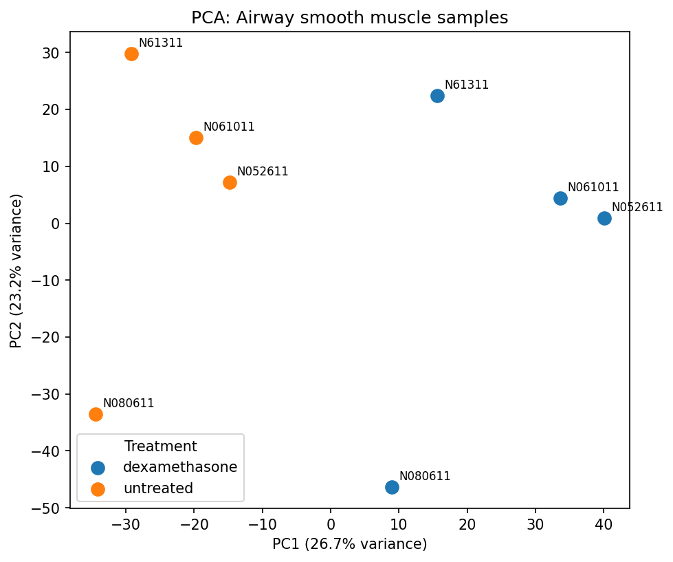
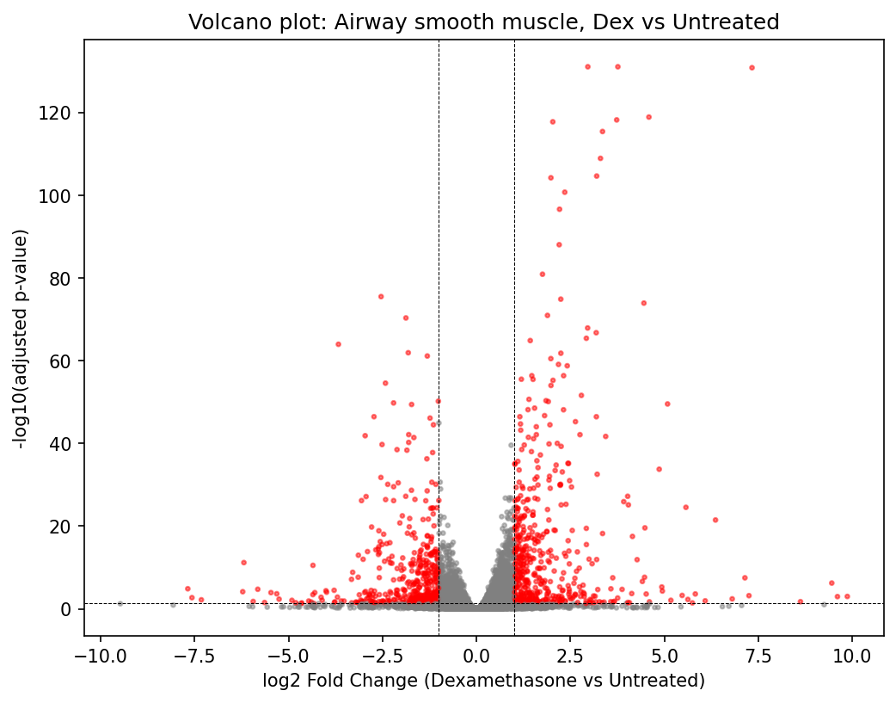

# Dexamethasone Response in Airway Smooth Muscle Cells: an RNA-seq Case Study

*This is my second bioinformatics project, following [dna-analyzer](https://github.com/minos1232/dna-analyzer), a from-scratch sequence analysis toolkit. This project moves from implementing core algorithms by hand to running a full, real-world RNA-seq pipeline on public data — from raw sequencing reads to a biological conclusion.*

## Biological question

Dexamethasone is a synthetic corticosteroid used clinically to control airway inflammation in asthma. This project asks: **which genes change expression in human airway smooth muscle cells in response to dexamethasone treatment, and what biological processes do those genes belong to?**

## Dataset

- **Source:** [GSE52778](https://www.ncbi.nlm.nih.gov/geo/query/acc.cgi?acc=GSE52778) (NCBI GEO / SRA)
- **Design:** 4 donors, each contributing one untreated and one dexamethasone-treated sample (8 samples total, paired by donor)
- **Sequencing:** paired-end Illumina RNA-seq

| Donor | Untreated | Dexamethasone |
|---|---|---|
| N61311 | SRR1039508 | SRR1039509 |
| N052611 | SRR1039512 | SRR1039513 |
| N080611 | SRR1039516 | SRR1039517 |
| N061011 | SRR1039520 | SRR1039521 |

The paired structure (same donor in both conditions) lets the analysis separate donor-to-donor baseline variation from the treatment effect, rather than mixing the two together.

## Method

**1. Data acquisition** — raw reads downloaded from SRA with `prefetch` / `fasterq-dump`.

**2. Quality control** — adapter trimming and quality filtering with `fastp`. All 8 samples showed high baseline quality (≥92% Q30 bases), minimal adapter contamination, and ~93-95% of reads passing filtering.

**3. Quantification** — reads pseudo-aligned to the GENCODE v50 human transcriptome using `salmon`, with a decoy-aware index (full genome included as decoy sequence) to reduce misassignment of genomic/intronic reads to similar transcripts. Mapping rates were consistently 94-96% across all samples.

**4. Gene-level counts** — transcript-level Salmon output aggregated to gene level using a transcript→gene mapping built directly from the GENCODE transcriptome FASTA headers, then rounded to integer counts.

**5. Differential expression** — analyzed with `PyDESeq2`, using the design formula `~ donor + treatment` to account for the paired structure. Genes with fewer than 10 total reads across all samples were filtered out before testing (82,323 → 24,163 genes).

**6. Pathway enrichment** — significant genes tested against GO Biological Process, KEGG, and Reactome gene sets using `gseapy` / Enrichr, at two thresholds: a broad list (padj < 0.05) and a stricter list (padj < 0.01, |log2FC| > 1).

## Why these tools

- **`prefetch` / `fasterq-dump` over plain `fastq-dump`** — `fasterq-dump` is the current recommended SRA-to-FASTQ converter (faster, multi-threaded); pairing it with `prefetch` first makes large downloads resumable if interrupted, rather than restarting from zero.
- **`fastp` over older QC tools (e.g. Trimmomatic, FastQC+Cutadapt separately)** — `fastp` combines adapter detection, quality trimming, and reporting in a single fast tool with sensible defaults, rather than chaining several slower, separately-configured tools together.
- **`salmon` (pseudoalignment) over traditional aligners (STAR, HISAT2)** — since the goal here is gene/transcript-level quantification rather than variant calling or novel splice discovery, a full base-by-base genome alignment isn't necessary. Salmon's pseudoalignment is substantially faster and, with a decoy-aware index (genome sequence included alongside the transcriptome), avoids the accuracy trade-off that pseudoalignment without decoys can have — reads from genomic/intronic contamination are correctly flagged as decoys rather than misassigned to a similar transcript.
- **`PyDESeq2` over edgeR/limma-voom** — DESeq2 (and its Python port, PyDESeq2) is the most widely used and cited tool for this exact task, models raw counts directly with a negative binomial distribution suited to RNA-seq data, and its dispersion-shrinkage approach is specifically well-suited to small sample sizes like this dataset's 4-per-group design. Using the Python port kept the entire pipeline in one language rather than switching to R partway through.
- **`gseapy` / Enrichr over GSEA (rank-based) or manual pathway lookup** — Enrichr-style over-representation analysis is simpler to run and interpret for a first pathway analysis than full rank-based GSEA, and `gseapy` provides a straightforward Python interface to it (plus GO, KEGG, and Reactome simultaneously) rather than requiring a separate R environment or manual web-based lookups per gene set.
- **Conda-isolated environment over system-wide (`apt`) installs** — bioinformatics tools change quickly and have specific, sometimes conflicting dependency versions; an isolated per-project conda environment keeps this reproducible and avoids breaking other tools on the system.
- **Jupyter notebook for the analysis stage, plain script for data prep** — building the count matrix (`build_count_matrix.py`) is a linear, run-once-and-save step, so a plain script suits it. The PyDESeq2/enrichment stage benefits from a notebook instead: results, plots, and enrichment tables needed to be inspected and iterated on interactively (e.g. rerunning enrichment at a stricter threshold after reviewing the first result) without re-running the slow upstream steps each time.

## Results

### Sample clustering (PCA)



Principal component 1 (26.7% of variance) cleanly separates every treated sample from its matched untreated sample, in the same direction for all 4 donors. Principal component 2 (23.2% of variance) largely reflects donor identity. This is a strong independent confirmation that the treatment effect is real, consistent, and distinguishable from person-to-person variability, before looking at any individual gene.

### Differential expression



**3,379 genes** were significantly differentially expressed (padj < 0.05) out of 24,163 tested, with more and stronger genes up-regulated than down-regulated in the dexamethasone condition. The top hit by fold change and significance was **DUSP1**, a textbook glucocorticoid-responsive gene — a reassuring internal validation that the pipeline recovers expected, previously-documented biology.

### Pathway enrichment

The broad significant gene list was dominated by general signal transduction, receptor tyrosine kinase signaling, and cytoskeletal remodeling pathways (e.g. focal adhesion, regulation of actin cytoskeleton) — consistent with dexamethasone's known effects on smooth muscle cell shape and migration, though broad given the large gene list size.

Applying a stricter threshold (padj < 0.01, |log2FC| > 1) sharpened this into a more specific, clinically relevant signature, including:
- **Interleukin-4 and Interleukin-13 signaling** (Reactome) — a pathway central to Th2-driven airway inflammation in asthma
- **Muscle contraction** (Reactome) — directly relevant given the cell type
- **Inflammatory mediator regulation of TRP channels** (KEGG)

## Interpretation

Dexamethasone produces a broad, statistically robust, and biologically coherent transcriptional response in airway smooth muscle cells. The response includes well-documented glucocorticoid target genes (DUSP1) alongside a pathway signature — anti-inflammatory (IL-4/IL-13 signaling) and smooth-muscle-specific (muscle contraction, cytoskeletal remodeling) — consistent with how corticosteroids are understood to relieve airway inflammation and hyperresponsiveness in asthma.

## Limitations

- Small sample size (n=4 per group) limits statistical power for individual gene dispersion estimates; PyDESeq2 flagged this directly via a low-residual-degrees-of-freedom warning during dispersion fitting.
- The broad (padj < 0.05 only) enrichment result reflects the size of the input gene list as much as biology — the stricter threshold result is likely the more specific and reliable signal.
- This analysis reflects one cell type (airway smooth muscle) and one glucocorticoid; findings should not be generalized to other tissues or corticosteroids without further validation.

## Cross-Language Statistical Analysis & QC (R & Python)

In addition to the main PyDESeq2 differential expression pipeline, the `scripts/` directory provides modular R and Python implementations of core statistical normalization and quality control workflows:

* **Principal Component Analysis (`scripts/R/pca_analysis.R`):** Filters zero-variance genes, applies $\log_2(\text{count} + 1)$ transformation, and performs scaled PCA (`ggplot2`) to evaluate sample clustering across dexamethasone treatment and donor identity.
* **Row-Wise Z-Score Normalization (`scripts/R/zscore_normalization.R`, `scripts/python/zscore_normalization.py`):** Filters strictly significant DEGs (`padj < 0.01`, $|\log_2\text{FC}| > 2$) and standardizes gene expression across samples ($Z = \frac{x - \mu}{\sigma}$) for downstream heatmap visualization.
* **Biological Replicate Reproducibility (`scripts/R/replicate_regression.R`, `scripts/python/replicate_regression.py`):** Evaluates expression concordance across ~60,000 genes between untreated biological replicates (`SRR1039508` vs. `SRR1039512`) using Pearson correlation ($r = 0.977$), coefficient of determination ($R^2 = 0.954$), and ordinary least-squares linear regression.

## Reproducing this analysis

```text
raw_data/       # downloaded FASTQ files (not included, see SRA accessions above)
qc/             # fastp-trimmed FASTQ + QC reports
reference/      # GENCODE v50 transcriptome, genome, and derived mapping files
salmon_index/   # decoy-aware Salmon index
quant/          # per-sample Salmon quantification output
results/        # count matrix, metadata, DE results, plots, enrichment output
scripts/        # modular R (scripts/R/) and Python (scripts/python/) QC & stats scripts
```

Environment: Python 3.10, conda environment with `sra-tools`, `fastp`, `salmon`, `pydeseq2`, `gseapy`, `pandas`, `scipy`, plus R (`tidyverse`, `ggplot2`). See `build_count_matrix.py` and `analysis.ipynb` for the main pipeline code, and `scripts/` for standalone R and Python statistical scripts.

### Quick Start

```bash
# 1. Clone the repository
git clone [https://github.com/minos1232/airway-rnaseq.git](https://github.com/minos1232/airway-rnaseq.git)
cd airway-rnaseq

# 2. Rebuild count matrix and launch main notebook
python build_count_matrix.py
jupyter notebook analysis.ipynb

# 3. Run standalone R and Python statistical QC scripts
python scripts/python/zscore_normalization.py
python scripts/python/replicate_regression.py
Rscript scripts/R/pca_analysis.R
Rscript scripts/R/zscore_normalization.R
Rscript scripts/R/replicate_regression.R
```
